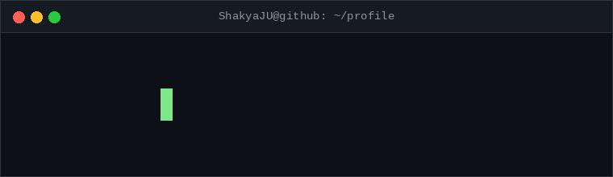
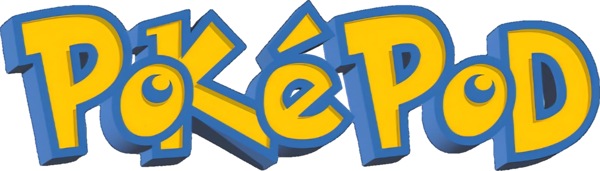
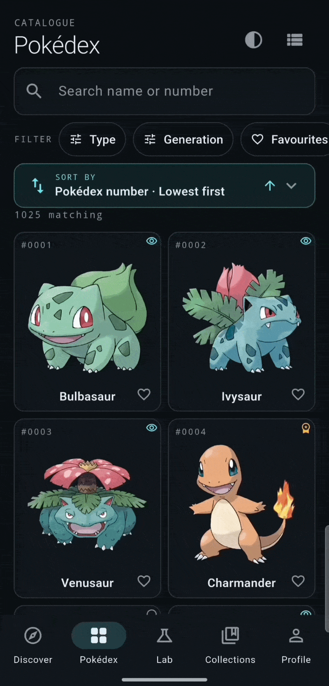
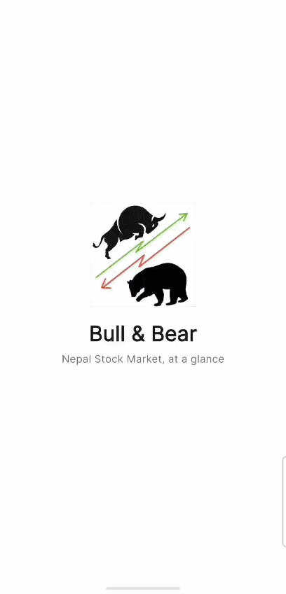
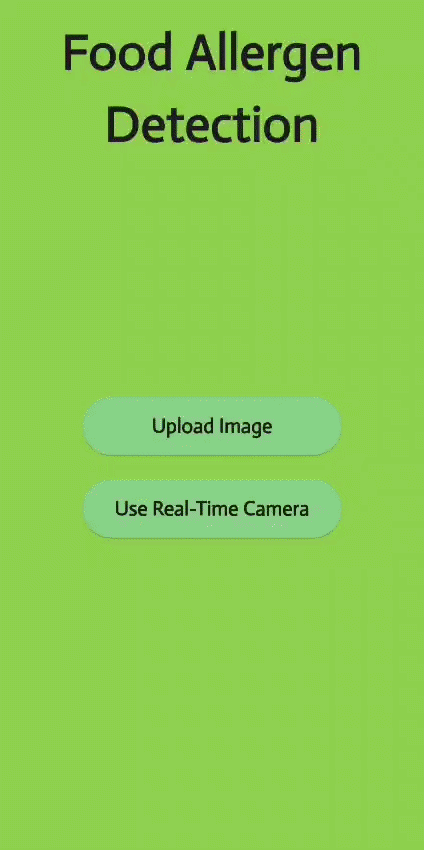

  

  

  

  
  
  
  

---

## 🚀 Featured Project

<h3>Beyond the Pokédex.</h3>

An unofficial Pokémon research, challenge and discovery companion, built end to end with Flutter.

  
  
  
  
  
  
  

<b>1,025 species · 9 generations · 20 achievements · 4 widget sizes · 327 tests</b>

  
  

<!--

  

-->
PokéPod treats the Pokédex as a research instrument rather than a list. You browse the Pokédex, record what you have discovered, studied and mastered, compare specimens, build teams and play a daily "Who's That Pokémon?" challenge. Everything is stored "locally on the device" no account, no backend.

<table align="center">
  <tr>
    <td align="center" valign="top" width="33%">
       
      <b>Who's That Pokémon?</b> Daily challenge with a progressive reveal
    </td>
     <td align="center" valign="top" width="33%">
       
      <b>Pokédex</b> Pokédex · search, filters and sorting
    </td>
    <td align="center" valign="top" width="33%">
       
      <b>Evolution Constellation</b> Interactive evolution graph
    </td>
    <td align="center" valign="top" width="33%">
       
      <b>Android widgets</b> Demo for two widgets
    </td>
  </tr>
</table>

<table>
  <tr>
    <td width="50%" valign="top">

**🔭 Research, not just a list**
Discovered, Studied and Mastered stages that only you advance.

**🧬 Analysis that explains itself**
Two-Pokémon comparison, data-backed "Unexpected Connections" and team coverage with written reasoning.

**🎯 A daily challenge**
One Pokémon per local calendar day, six guesses, progressive clues, streaks and a staged picture reveal.

</td>
    <td width="50%" valign="top">

**📱 Native Android widgets**
The Specimen of the Day on the home screen in four sizes.

**🔔 Opt-in local reminders**
Scheduled in the device's time zone, with permission explained before the system prompt.

**🏆 20 achievements, 9 rarity tiers**
Unlocked from real progress, each with a progress bar.

</td>
  </tr>
</table>

### What it demonstrates

- **State and dependency injection with Riverpod.** One mechanism for state, repositories and the HTTP client; tests override any of them.
- **A cache-first repository layer.** Screens never see HTTP; identical in-flight requests are de-duplicated, and previously opened content works offline.
- **Domain logic in pure Dart.** The type chart, team analysis, filtering, sorting, evolution layout, achievements and the daily challenge are tested without any UI (327 automated tests).
- **Careful game design.** A date-seeded shuffle of the full National Dex, a saved answer per day, explicit win and loss states, and fair streak rules.
- **Local-first privacy.** No accounts, analytics or ads; backup and restore with validation and confirmation.
- **Honest documentation.** The README lists known limitations, such as Android-only widgets and the platforms that have not been built.

  
  
  
  
  

PokéPod is an unofficial fan project and is not affiliated with Nintendo, The Pokémon Company or Game Freak. Pokémon names and artwork belong to their respective owners.

<a href="https://github.com/ShakyaJU/pokepod"><b>Explore PokéPod on GitHub →</b></a>

---

## 🌟 More Projects

### 📈 [Bull & Bear](https://github.com/ShakyaJU/bull-and-bear)

  
  
  

<table>
  <tr>
    <td width="60%" valign="top">
      <h4>📱 Features</h4>
      <ul>
        <li><strong>Home Dashboard</strong> — NEPSE index, market summary, top gainers and losers.</li>
        <li><strong>Watchlist</strong> — track favorite stocks and price changes.</li>
        <li><strong>Market</strong> — search listed companies by name, symbol, or sector.</li>
        <li><strong>Portfolio</strong> — track holdings, investment value, and profit/loss.</li>
        <li><strong>Settings &amp; Data</strong> — theme customization, manual refresh, auto-refresh, and app information.</li>
        <li><strong>Data Fallback</strong> — labels demo data when the live feed is unavailable.</li>
        <li><strong>Custom Branding</strong> — branded splash screen and app icon.</li>
        <li><strong>Navigation</strong> — Home, Watchlist, Market, Portfolio, and More.</li>
      </ul>
      <h4>⚠️ Disclaimer</h4>
      
Bull &amp; Bear uses an unofficial NEPSE data API for educational purposes and is not affiliated with NEPSE. Prices may be delayed; demo data is clearly labeled. Portfolio data is stored locally and is not connected to any broker or bank.

    </td>
    <td width="40%" align="center" valign="top">
      
    </td>
  </tr>
</table>

---

### 🍽️ [Food Allergen Detection](https://github.com/ShakyaJU/Food_Allergen_Detection)

  
  
  
  

<table>
  <tr>
    <td width="60%" valign="top">
      <h4>📱 Key Features</h4>
      <ul>
        <li><strong>Image Upload</strong> — upload food images for allergen detection.</li>
        <li><strong>Real-Time Camera</strong> — capture food images directly through the mobile app.</li>
        <li><strong>Machine Learning</strong> — uses a CNN model to analyze food images and predict potential allergens.</li>
        <li><strong>Flutter Interface</strong> — a mobile-friendly interface for submitting images and viewing predictions.</li>
      </ul>
      <h4>🚀 Technologies Used</h4>
      <ul>
        <li><strong>Frontend:</strong> Flutter (Dart)</li>
        <li><strong>Backend:</strong> Flask (Python)</li>
        <li><strong>Machine Learning:</strong> TensorFlow/Keras, CNN, ResNet50V2</li>
      </ul>
      <h4>⚠️ Disclaimer</h4>
      
Predictions are model-generated and may not identify every allergen. Do not rely on this application alone to determine whether food is safe for someone with an allergy.

    </td>
    <td width="40%" align="center" valign="top">
      
    </td>
  </tr>
</table>

---

## 🛠 Tech Stack

<table align="center">
  <tr>
    <td align="center"><b>Mobile</b></td>
    <td align="center"></td>
  </tr>
  <tr>
    <td align="center"><b>AI &amp; Backend</b></td>
    <td align="center"></td>
  </tr>
  <tr>
    <td align="center"><b>Languages</b></td>
    <td align="center"></td>
  </tr>
  <tr>
    <td align="center"><b>Tools</b></td>
    <td align="center"></td>
  </tr>
</table>

---

## 📬 Connect with Me

  
  
  

Open to Flutter and mobile development conversations. Thanks for stopping by.

